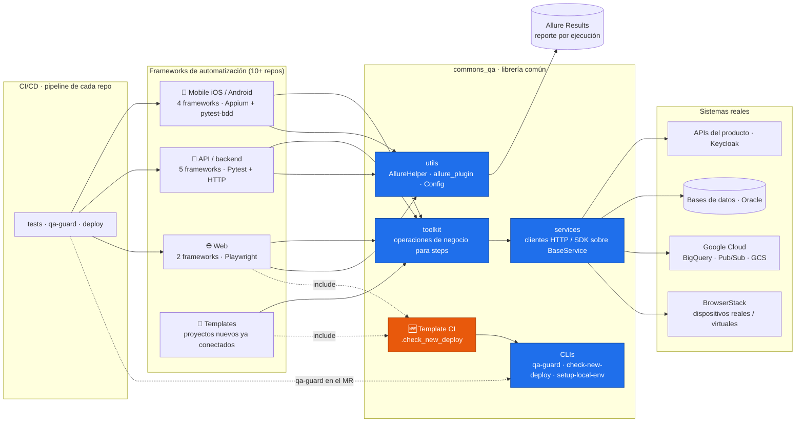
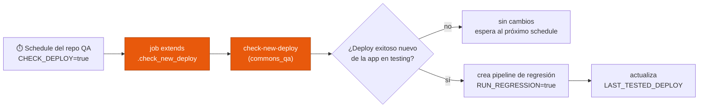
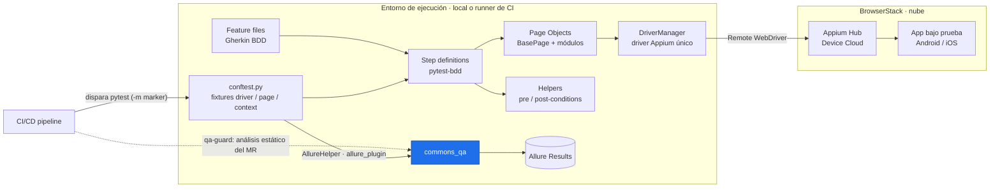

# Gonzalo Porta · QA Technical Lead

Portfolio personal publicado en **[gportabopp.github.io](https://gportabopp.github.io)**.

QA Technical Lead en Buenos Aires, con foco en automatización web, mobile (iOS / Android) y backend, y en arquitectura de soluciones de testing reutilizables.

[LinkedIn](https://www.linkedin.com/in/gonzalo-porta-b53343184/) · [CV en español](cv/Gonzalo_Porta_CV_ES.pdf) · [CV in English](cv/Gonzalo_Porta_CV_EN.pdf)

---

## 🏗️ Arquitectura de soluciones de QA

Diseñé y mantengo **`commons_qa`**, una librería Python interna que funciona como capa común entre todos los frameworks de automatización de QA de una billetera digital. El código es privado; estos diagramas muestran la arquitectura en términos generales, sin datos internos.

### Diagrama transversal

Cada repo de automatización corre sus tests desde su propio pipeline y entra a `commons_qa` para preparar datos, hablar con los sistemas reales, reportar en Allure, validar sus merge requests con `qa-guard` y, desde un template de CI, detectar deploys nuevos de la app para disparar la regresión.

### 🆕 Detección automática de deploys (`check-new-deploy`)

Los repos de QA incluyen un template de CI de `commons_qa` y, desde un pipeline programado, detectan cuándo la app tiene un deploy nuevo en el ambiente de testing. Si lo hay, disparan la regresión sin esperar a que el equipo de infraestructura avise.

### Ejemplo de punta a punta: framework mobile

Así recorre la arquitectura un test mobile, desde el escenario Gherkin hasta la app instalada en un dispositivo de BrowserStack. Los demás frameworks repiten el patrón: cambia la capa de ejecución (Appium, Playwright o HTTP), pero el ingreso a `commons_qa` para fixtures, reportes y gobierno es el mismo.

---

## 📁 Contenido del repo

| Archivo | Qué es |
|---|---|
| `index.html` | El portfolio (una sola página, en español e inglés) |
| `cv/` | CV en PDF, en español e inglés |
| `img/` | Foto del portfolio |
